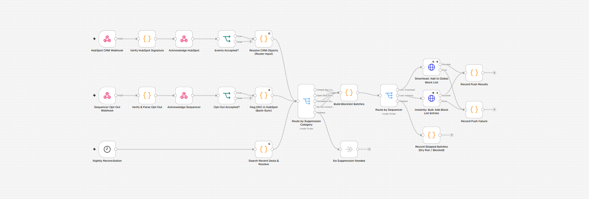

# n8n-outbound-sequencer-crm-suppression-sync

A bi-directional **suppression firewall** between HubSpot and the outbound sequencers **Smartlead** and **Instantly**.

Within seconds of a CRM change, it pushes four kinds of records into both tools' **global blocklists**:

- **Closed-Won customers**,
- **open-deal domains**,
- **competitor domains**,
- **Do Not Contact opt-outs**.

When a lead unsubscribes inside one sequencer, it flags the contact in HubSpot and blocks the address in the other sequencer too.

I built it for one failure mode: a cold sequence going out to a company that's mid-negotiation, already a customer, or already asked to be left alone. That's the most expensive outbound mistake there is, and it's almost always a sync gap rather than bad intent.

What's in the repo:

- **`workflow.json`**: an importable n8n workflow with three entry points (HubSpot webhook, sequencer opt-out webhook, nightly reconciliation), a category router, native **HTTP Request** nodes for the Smartlead and Instantly blocklist APIs, retries, and error branches.
- **A Node.js mirror** (`src/index.js`) running the same code as a small HTTP server or a cron job.
- **`src/core/`**: the shared logic. The workflow's Code nodes are generated from it, and the tests run those nodes against a fake HubSpot API and compare them with the mirror.

Out of the box it pushes nothing: `DRY_RUN=true`, `SANDBOX_MODE=true`, and every credential is a placeholder such as `YOUR_HUBSPOT_PRIVATE_APP_TOKEN_HERE`.

---

## Contents

1. [Architecture overview](#architecture-overview)
2. [Router and mapping logic](#router-and-mapping-logic)
3. [Smartlead and Instantly blocklist APIs](#smartlead-and-instantly-blocklist-apis)
4. [Trigger configuration](#trigger-configuration)
5. [Environment variables](#environment-variables)
6. [Deployment](#deployment)
7. [Testing](#testing)
8. [Troubleshooting](#troubleshooting)
9. [Repository layout](#repository-layout)

---

## Architecture overview



```
 ┌───────────────────────── 1. CRM → SEQUENCERS (seconds) ─────────────────────────┐
 │ HubSpot webhook (deal / company / contact events, batched up to 100 per call)   │
 │   → Verify HubSpot Signature      X-HubSpot-Signature-v3 (or shared secret),    │
 │                                   5-minute replay window, event parsing         │
 │   → Acknowledge HubSpot           200 right away (401 on bad signature)         │
 │   → Events Accepted?                                                            │
 │   → Resolve CRM Objects           deal → companies + contacts, company, contact │
 └──────────────────────────────────────┬──────────────────────────────────────────┘
 ┌───────────── 2. SEQUENCER → CRM ─────┼──────────────────────────────────────────┐
 │ Smartlead / Instantly webhook        │   (?source=…&token=…)                     │
 │   → Verify & Parse Opt-Out → Acknowledge Sequencer → Opt-Out Accepted?          │
 │   → Flag DNC in HubSpot (Back-Sync)   outbound_do_not_contact = true            │
 └──────────────────────────────────────┼──────────────────────────────────────────┘
 ┌───────────── 3. RECONCILIATION ──────┼──────────────────────────────────────────┐
 │ Nightly 02:15 UTC → Search Recent Deals & Resolve (last 26 h + COMPETITOR_DOMAINS)│
 └──────────────────────────────────────┼──────────────────────────────────────────┘
                                        ▼
                    Route by Suppression Category  (Switch)
          Closed-Won Customer │ Open Deal Domain │ Competitor Domain │ Do Not Contact
                                        ▼                      (fallback → No Suppression Needed)
                         Build Blocklist Batches   (≤100 values per batch, per sequencer)
                                        ▼
                         Route by Sequencer  (Switch on mode:sequencer)
             live:smartlead            live:instantly             dry_run / blocked
                  ▼                          ▼                           ▼
   Smartlead: Add to Global     Instantly: Bulk Add Block     Record Skipped Batches
   Block List (HTTP Request)    List Entries (HTTP Request)   (Dry Run / Blocked)
                  └──── success → Record Push Results ── error → Record Push Failure
```

Design decisions I made:

- **Acknowledge first, then work.** HubSpot retries webhooks that respond slowly, so the signature is checked and the `Respond to Webhook` node answers before any CRM lookups.
- **Re-fetch, don't trust the event.** Webhook events only carry IDs and the changed property. The resolver reads the deal, its associated companies and contacts, and their current properties from the API.
- **Fail closed.** Entries are only ever *added*. A closed-lost deal is reported as a release candidate but never removed from a blocklist automatically, because a removal mistake means emailing someone who asked not to be emailed.
- **Free-mail safety.** If a contact uses `gmail.com`, blocking the domain would block everyone on Gmail. Free-mail domains are never blocked as domains; the individual address is blocked instead.
- **Protected and internal domains** (`PROTECTED_DOMAINS`, `INTERNAL_DOMAINS`) are never pushed.
- **Keys stay in the environment.** The HTTP Request nodes read keys from `$env`. Batch items carry URLs and values only, so execution data never contains a key.

---

## Router and mapping logic

| HubSpot signal | Category (Switch output) | What gets blocked |
| --- | --- | --- |
| Deal with `hs_is_closed_won = true` | **Closed-Won Customer** | Associated companies' `domain` and `hs_additional_domains`; free-mail contact emails |
| Deal not closed (optionally only `OPEN_DEAL_PIPELINES`) | **Open Deal Domain** | Same as above |
| Deal closed-lost | *(nothing)* | Logged as a release candidate |
| Company `COMPETITOR_PROPERTY` ∈ `COMPETITOR_VALUES` (default `type = COMPETITOR`), or domain in `COMPETITOR_DOMAINS` | **Competitor Domain** | Company domains |
| Company or contact `lifecyclestage = customer` | **Closed-Won Customer** | Company domains / contact email |
| Contact with any `DNC_PROPERTIES` true (default `hs_email_optout`, `outbound_do_not_contact`) | **Do Not Contact Opt-Out** | Contact email |
| Sequencer unsubscribe event | **Do Not Contact Opt-Out** | Email, pushed to the *other* sequencer; HubSpot flagged |

Normalization: `https://www.Prospect.Example/pricing` → `prospect.example`; emails are lowercased and validated. A company with no domain falls back to its contacts' corporate domains. When one value qualifies for several categories, it's pushed once and keeps every category in the log.

---

## Smartlead and Instantly blocklist APIs

| | Smartlead | Instantly (API v2) |
| --- | --- | --- |
| Endpoint | `POST https://server.smartlead.ai/api/v1/leads/add-domain-block-list` | `POST https://api.instantly.ai/api/v2/block-lists-entries/bulk-create` |
| Auth | `?api_key=` query parameter | `Authorization: Bearer <key>` (scope `block_list_entries:create` or broader) |
| Body | `{ "domain_block_list": ["acme.example", "person@gmail.com"], "client_id": 123 }` (`client_id` optional) | `{ "bl_values": ["acme.example", "person@gmail.com"] }` |
| Accepts | Domains and email addresses | Domains and email addresses |
| n8n node | `Smartlead: Add to Global Block List` | `Instantly: Bulk Add Block List Entries` |
| Key used | `SMARTLEAD_SANDBOX_API_KEY` when `SANDBOX_MODE=true`, else `SMARTLEAD_API_KEY` | `INSTANTLY_SANDBOX_API_KEY` when `SANDBOX_MODE=true`, else `INSTANTLY_API_KEY` |

Batches are capped at `BATCH_SIZE` (100) values. Both HTTP nodes retry three times (2 s apart), then route to `Record Push Failure`. Re-adding a value that's already blocked is harmless, so retries and reconciliation passes are idempotent. Check both providers' current API references before going live; endpoints and limits can change.

**Sandbox mode** means separate sequencer accounts: a second Smartlead account (or agency client), and a separate Instantly workspace with its own API key. If the sandbox key is still a placeholder, batches are marked `blocked` and nothing is sent.

---

## Trigger configuration

### 1. HubSpot → n8n (primary, real time)

I configured this with HubSpot **app webhooks**, which a private app supports:

1. In HubSpot: **Settings → Integrations → Private Apps → Create**. Scopes:
   - `crm.objects.deals.read`, `crm.objects.companies.read`
   - `crm.objects.contacts.read`, `crm.objects.contacts.write` (the write scope is only for the back-sync)
2. In the app's **Webhooks** tab, set the target URL to the n8n production URL, `https://<your-n8n>/webhook/hubspot-suppression`. Subscribe to:
   - `deal.creation`, `deal.propertyChange` → `dealstage`
   - `company.creation`, `company.propertyChange` → `type`, `lifecyclestage`, `domain`
   - `contact.propertyChange` → `hs_email_optout`, `outbound_do_not_contact`, `lifecyclestage`
3. Set `WEBHOOK_AUTH_MODE=hubspot_v3`, put the app's **client secret** into `WEBHOOK_SIGNING_SECRET`, and set `PUBLIC_WEBHOOK_URL` to the exact URL from step 2 (scheme, host, path, and any query string). The v3 signature is computed over that string, so a proxy that rewrites the host breaks verification.

Alternative: **HubSpot workflow webhooks.** If you'd rather drive this from HubSpot workflows (for example "deal stage is Closed won"), add a *Send a webhook* action. Send a header named `WEBHOOK_SHARED_SECRET_HEADER` (default `x-webhook-secret`) carrying `WEBHOOK_SIGNING_SECRET`, and set `WEBHOOK_AUTH_MODE=shared_secret`. The body can be the classic payload (`objectId`, with `?objectType=deal` on the URL) or `{ "objectType": "deal", "objectId": "123" }`.

**About n8n's HubSpot Trigger node:** it requires a HubSpot *developer (public) app* with OAuth credentials. I used a plain Webhook node so the same workflow works with a private app and with workflow webhooks, and so the raw body is available for signature checks. If you already run a developer app, you can swap the HubSpot Trigger node in front of `Resolve CRM Objects`. Its events have the same `subscriptionType` / `objectId` shape.

Create the DNC property used by the back-sync:

```bash
export HUBSPOT_PRIVATE_APP_TOKEN=YOUR_HUBSPOT_PRIVATE_APP_TOKEN_HERE
hs() { curl -sS -X POST "https://api.hubapi.com$1" -H "Authorization: Bearer $HUBSPOT_PRIVATE_APP_TOKEN" -H "Content-Type: application/json" -d "$2"; echo; }
hs /crm/v3/properties/contacts '{"name":"outbound_do_not_contact","label":"Outbound Do Not Contact","type":"bool","fieldType":"booleancheckbox","groupName":"contactinformation","options":[{"label":"Yes","value":"true","displayOrder":0},{"label":"No","value":"false","displayOrder":1}]}'
hs /crm/v3/properties/contacts '{"name":"outbound_dnc_source","label":"Outbound DNC Source","type":"string","fieldType":"text","groupName":"contactinformation"}'
hs /crm/v3/properties/contacts '{"name":"outbound_dnc_at","label":"Outbound DNC At","type":"datetime","fieldType":"date","groupName":"contactinformation"}'
```

(The property script needs `crm.schemas.contacts.write` once.) The back-sync never touches `hs_email_optout`. HubSpot's marketing subscription status stays under HubSpot's own subscription tools.

### 2. Smartlead / Instantly → n8n (opt-out back-sync)

Point each tool's webhook at `https://<your-n8n>/webhook/sequencer-optout`:

- Smartlead campaign webhook: `...?source=smartlead&token=<SEQUENCER_WEBHOOK_SECRET>`, with the unsubscribe event selected.
- Instantly webhook: `...?source=instantly&token=<SEQUENCER_WEBHOOK_SECRET>`, with the unsubscribe event selected.

Event names are matched case-insensitively against `SEQUENCER_OPT_OUT_EVENTS` (default `lead_unsubscribed,unsubscribed,lead_opted_out`). The email is read from `lead_email`, `to_email`, `sl_lead_email`, `email`, `lead.email`, or `data.email`. Send a test event from each tool and confirm the exact event name in the n8n execution; add it to the list if it differs. If a tool can send a custom header instead, `x-sequencer-secret` works too.

### 3. Nightly reconciliation

`Nightly Reconciliation` (cron `15 2 * * *`, UTC) searches deals modified in the last `RECONCILE_LOOKBACK_HOURS` (26, overlapping the previous run) and re-runs the same router. It also pushes `COMPETITOR_DOMAINS`. This catches webhooks lost during outages. For a first full backfill, temporarily raise `RECONCILE_LOOKBACK_HOURS` (for example to `8760`) and `RECONCILE_MAX_DEALS`, run it once in dry run, review the batches, then run it live.

---

## Environment variables

| Variable | Default | Purpose |
| --- | --- | --- |
| `DRY_RUN` | `true` | Build batches and log them; no blocklist push, no HubSpot write |
| `SANDBOX_MODE` | `true` | Use sandbox sequencer keys; HubSpot writes only to sandbox / developer-test portals |
| `PORT` / `WEBHOOK_MAX_BODY_BYTES` | `3000` / `1048576` | Node.js server |
| `WEBHOOK_AUTH_MODE` | `hubspot_v3` | `hubspot_v3` or `shared_secret` |
| `WEBHOOK_SIGNING_SECRET` | `YOUR_WEBHOOK_SECRET_HERE` | App client secret (v3) or shared secret |
| `PUBLIC_WEBHOOK_URL` | `YOUR_PUBLIC_WEBHOOK_URL_HERE` | Exact URL HubSpot calls (required for v3, live) |
| `WEBHOOK_SHARED_SECRET_HEADER` / `SIGNATURE_MAX_AGE_SECONDS` | `x-webhook-secret` / `300` | Shared-secret header / replay window |
| `SEQUENCER_WEBHOOK_SECRET` | `YOUR_SEQUENCER_WEBHOOK_SECRET_HERE` | `token` query value (or `x-sequencer-secret` header) for sequencer webhooks |
| `SEQUENCER_OPT_OUT_EVENTS` | `lead_unsubscribed,unsubscribed,lead_opted_out` | Event names treated as opt-outs |
| `BACK_SYNC_TO_HUBSPOT` / `CROSS_SEQUENCER_SYNC` | `true` / `true` | Opt-out handling |
| `HUBSPOT_PRIVATE_APP_TOKEN` | `YOUR_HUBSPOT_PRIVATE_APP_TOKEN_HERE` | Private App token |
| `HUBSPOT_SANDBOX_PORTAL_ID` | `YOUR_HUBSPOT_SANDBOX_PORTAL_ID_HERE` | Optional sandbox pin |
| `HUBSPOT_DNC_PROPERTY` / `MAX_CONTACTS_PER_DEAL` | `outbound_do_not_contact` / `50` | Back-sync property / contact cap per deal |
| `SUPPRESS_CLOSED_WON` / `SUPPRESS_OPEN_DEALS` / `SUPPRESS_COMPETITORS` / `SUPPRESS_DNC` / `SUPPRESS_CUSTOMER_LIFECYCLE` | `true` | Rule switches |
| `OPEN_DEAL_PIPELINES` | — | Limit open-deal suppression to these pipeline IDs |
| `COMPETITOR_PROPERTY` / `COMPETITOR_VALUES` / `COMPETITOR_DOMAINS` | `type` / `competitor` / — | Competitor detection |
| `DNC_PROPERTIES` | `hs_email_optout,outbound_do_not_contact` | Contact properties meaning do-not-contact |
| `PROTECTED_DOMAINS` / `INTERNAL_DOMAINS` | — / `YOUR_COMPANY_DOMAIN_HERE` | Never blocked |
| `BLOCK_CONTACT_EMAILS_FOR_FREEMAIL` | `true` | Block free-mail contacts by address |
| `SYNC_SMARTLEAD` / `SMARTLEAD_API_KEY` / `SMARTLEAD_SANDBOX_API_KEY` / `SMARTLEAD_CLIENT_ID` / `SMARTLEAD_BASE_URL` | `true` / placeholders / — / `https://server.smartlead.ai/api/v1` | Smartlead |
| `SYNC_INSTANTLY` / `INSTANTLY_API_KEY` / `INSTANTLY_SANDBOX_API_KEY` / `INSTANTLY_BASE_URL` | `true` / placeholders / `https://api.instantly.ai/api/v2` | Instantly |
| `BATCH_SIZE` | `100` | Values per blocklist request (max 500) |
| `RECONCILE_LOOKBACK_HOURS` / `RECONCILE_MAX_DEALS` | `26` / `2000` | Reconciliation window |
| `LOG_WEBHOOK_URL` | `YOUR_LOG_WEBHOOK_URL_HERE` | Optional HTTPS endpoint for aggregate run summaries |

Values are fail-safe: `DRY_RUN` and `SANDBOX_MODE` only turn off with `false`, `0`, `no`, or `off`. With `DRY_RUN=false`, the workflow refuses to run (`500 config_invalid`) while any required secret or key is still a placeholder.

---

## Deployment

### n8n

1. **Import:** Workflows → Import from File → `workflow.json`.
2. **Host settings:** set `NODE_FUNCTION_ALLOW_BUILTIN=crypto` and `N8N_BLOCK_ENV_ACCESS_IN_NODE=false`, plus the variables from `.env.example` (keep `DRY_RUN=true` and `SANDBOX_MODE=true`). Restart n8n.
3. **Webhook URLs:** copy the production URLs of `HubSpot CRM Webhook` (`/webhook/hubspot-suppression`) and `Sequencer Opt-Out Webhook` (`/webhook/sequencer-optout`) into HubSpot and the sequencers. Set `PUBLIC_WEBHOOK_URL` to the HubSpot one.
4. **Activate**, then move a sandbox deal to Closed Won. Check the execution: `Build Blocklist Batches` shows the exact request bodies, and `Record Skipped Batches` shows them as `dry_run`.
5. **Sandbox live:** `DRY_RUN=false`, `SANDBOX_MODE=true`, with sandbox sequencer keys and a sandbox HubSpot token. Confirm the entries appear in the sandbox Smartlead global block list and the sandbox Instantly workspace.
6. **Production:** set the production keys and `SANDBOX_MODE=false`. Run one reconciliation with a long lookback in dry run first, so you can see how many entries a full backfill would add.

Notes:

- The workflow setting `saveDataSuccessExecution: none` keeps prospect emails out of the execution list. Failed executions are kept for debugging; prune them on a schedule.
- Code nodes are generated: change `src/core/`, run `npm run build:workflow`, and re-import. The tests fail if `workflow.json` drifts from a fresh build.

### Node.js mirror (without n8n)

```bash
cp .env.example .env
npm start              # POST /webhooks/hubspot, POST /webhooks/sequencer-optout, GET /healthz
npm run reconcile      # one reconciliation pass; schedule it with cron
npm run simulate       # offline run of every fixture (dry run)
```

```cron
15 2 * * *  cd /opt/suppression-sync && /usr/bin/node src/index.js --reconcile >> logs/reconcile.log 2>&1
```

Put the server behind HTTPS (a reverse proxy), and make sure the proxy passes the original host so `PUBLIC_WEBHOOK_URL` matches what HubSpot signs.

---

## Testing

```bash
npm test        # 23 tests, no network
npm run simulate
```

`tests/suppression.test.js` covers:

- **Config:** safe defaults, live-mode refusals.
- **Normalization:** domain and email normalization; free-mail, protected, and internal guards; de-duplication.
- **HubSpot webhooks:** v3 signature (valid, tampered, stale, missing), shared-secret mode, event parsing and de-duplication.
- **Router:** every category, closed-lost release candidates, rule switches and pipeline filters.
- **Batches:** request shapes, `client_id`, chunking, blocked mode, sandbox-key selection, no keys inside batches.
- **End to end:** an offline simulation with zero calls; a live sandbox push against a fake HubSpot API; opt-out back-sync with secret enforcement and sandbox refusal; reconciliation search window; HTTP server routes and limits.
- **n8n:** structure, Switch outputs, env-only keys on the HTTP nodes, error wiring, and rebuild equality. The real Code nodes run against the fake HubSpot API and produce exactly the batches the Node.js mirror produces.

Simulation output (fixtures, dry run):

- **HubSpot webhook:** 6 events → 6 entries (3 customer, 1 open deal, 1 competitor, 1 DNC) to both sequencers. The closed-lost deal is reported, and the internal contact is skipped.
- **Smartlead opt-out** → pushed to Instantly only. **Instantly opt-out** → pushed to Smartlead only.
- **Reconciliation:** recent deals plus `COMPETITOR_DOMAINS`.

---

## Troubleshooting

| Symptom | Likely cause and fix |
| --- | --- |
| HubSpot webhook gets `401 signature_mismatch` | `PUBLIC_WEBHOOK_URL` must equal the target URL byte for byte (including `https`, host, path, and query), and `WEBHOOK_SIGNING_SECRET` must be the app's client secret, not the access token. |
| `401 timestamp_outside_window` | Server clock drift, or a replayed request. Sync NTP, or raise `SIGNATURE_MAX_AGE_SECONDS` slightly. |
| `500 config_invalid` | Live mode with placeholders. The `Verify` node output lists every missing variable in `errors`. |
| Events accepted but `No Suppression Needed` | The deal has no associated company or contacts, or only free-mail/internal domains with `BLOCK_CONTACT_EMAILS_FOR_FREEMAIL=false`. Check `notes` and `skipped` in the resolver output. |
| Every batch lands in `Record Skipped Batches` with `blocked` | `SANDBOX_MODE=true` and the `*_SANDBOX_API_KEY` is still a placeholder, or the production key is missing with sandbox off. |
| Smartlead HTTP 401/403 | Wrong `SMARTLEAD_API_KEY` / `SMARTLEAD_SANDBOX_API_KEY`, or an agency key that needs `SMARTLEAD_CLIENT_ID`. |
| Instantly HTTP 401/403 | The key isn't a v2 key, or it lacks the `block_list_entries:create` scope. |
| Opt-out webhook `ignored: event_not_tracked:<name>` | Add `<name>` to `SEQUENCER_OPT_OUT_EVENTS`. |
| Opt-out webhook `no_email_in_payload` | The tool sends the address under another key. Add it to the candidate list in `parseSequencerOptOut` (`src/core/pipeline.js`) and rebuild. |
| Back-sync `contact_not_found` | The lead isn't in HubSpot yet. The cross-sequencer block still happens. |
| Back-sync `sandbox_account_required` | `SANDBOX_MODE=true` with a production HubSpot token. |
| Respond node doesn't pass items to the IF | Older n8n versions don't forward items from *Respond to Webhook*. Upgrade n8n, or connect `Verify …` directly to both the Respond node and the IF node. |
| Code node `Cannot find module 'crypto'` / `$env` denied | Set `NODE_FUNCTION_ALLOW_BUILTIN=crypto` and `N8N_BLOCK_ENV_ACCESS_IN_NODE=false`, then restart. |
| `this.helpers.httpRequest is not a function` | Your n8n version or task-runner setup doesn't expose the helper in Code nodes. Use the Node.js mirror, or upgrade n8n. |

---

## Repository layout

```
.
├── workflow.json                   # generated, importable n8n workflow
├── README.md
├── DISCLAIMER.md
├── LICENSE
├── .env.example
├── .gitignore
├── package.json
├── scripts/
│   └── build-workflow.js           # regenerates workflow.json from src/core/
├── src/
│   ├── index.js                    # HTTP server, --simulate, --reconcile
│   └── core/                       # shared by Node.js and n8n (embedded into Code nodes)
│       ├── config.js               # env loader, fail-safe flags, sandbox key selection, validation
│       ├── suppression.js          # domain/email normalization, free-mail and protected guards
│       ├── hubspotSync.js          # v3 signatures, event parsing, object resolution, DNC back-sync
│       ├── sequencers.js           # Smartlead / Instantly batch building and execution
│       └── pipeline.js             # router, opt-out flow, reconciliation, summaries
├── fixtures/
│   ├── hubspot-webhook-events.json
│   ├── offline-crm-objects.json
│   ├── smartlead-unsubscribe-webhook.json
│   └── instantly-unsubscribe-webhook.json
└── tests/
    └── suppression.test.js
```

---

## ⚠️ Disclaimer & Liability Limitation

**Use at your own risk.** The code, workflows, and scripts provided in this repository (`n8n-outbound-sequencer-crm-suppression-sync`) are for educational and architectural demonstration purposes.

* **No Liability:** The author and dhRobin Systems assume no responsibility or liability for any direct, indirect, incidental, or consequential damages resulting from the use, misuse, or deployment of these scripts.
* **No Warranty:** All software, n8n JSON blueprints, and JavaScript modules are provided "AS IS" without warranty of any kind, express or implied, including but not limited to merchantability, fitness for a particular purpose, or non-infringement.
* **Production Testing Required:** Always test thoroughly in an isolated staging environment (for example a HubSpot developer test account or sandbox, plus separate Smartlead and Instantly sandbox accounts) with `SANDBOX_MODE=true` and `DRY_RUN=true` enabled before connecting live HubSpot credentials. Treat every blocklist entry as long-lived, and review campaign lists before launch: suppression is a safety net, not a guarantee.
* **Third-Party APIs & Compliance:** Users are solely responsible for complying with the terms of service, rate limits, data privacy regulations (GDPR/CCPA), and security policies of HubSpot, Smartlead, Instantly, and any connected services. That includes confirming a lawful basis for sharing prospect and customer data with each sequencer, honouring every unsubscribe and do-not-contact request across every sending tool, and reviewing every automated blocklist entry and CRM property update.

The full disclaimer is also available in [DISCLAIMER.md](https://github.com/dhrobinsystems/n8n-outbound-sequencer-crm-suppression-sync/blob/main/DISCLAIMER.md).

## License

Full text: DISCLAIMER.md · Licensed under the MIT License. License: MIT © 2026 dhRobin Systems · Provided as-is, see the disclaimer.
